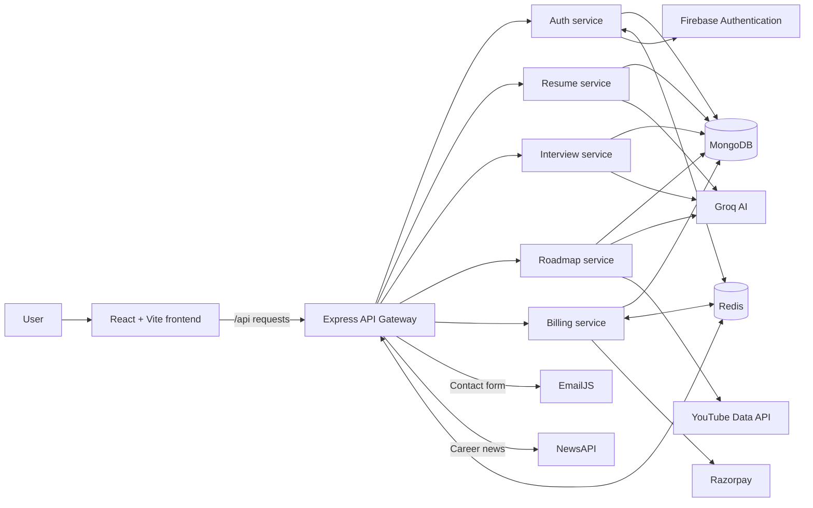

<div align="center">

# Intervue AI

### An AI-powered workspace for the full interview preparation journey

Prepare for your next opportunity with mock interviews, resume tools, actionable feedback, personalized learning plans, and application tracking in one place.

[](https://github.com/TheLearnerAllTime002/Intervue-AI)
[](https://react.dev/)
[](https://nodejs.org/)

[Explore the code](https://github.com/TheLearnerAllTime002/Intervue-AI) · [Report an issue](https://github.com/TheLearnerAllTime002/Intervue-AI/issues) · [Contact](https://github.com/TheLearnerAllTime002/Intervue-AI/issues/new)

</div>

---

## The project

Interview preparation often means jumping between a resume editor, question lists, practice tools, notes, and job trackers. Intervue AI brings those steps into a single workspace and connects preparation to follow-through: choose a target role, practice, review feedback, identify gaps, and plan what to work on next.

It is an open source career preparation application created by **Arjun Mitra** ([`@TheLearnerAllTime002`](https://github.com/TheLearnerAllTime002)). The product combines AI-assisted workflows with saved interview history, resume and application data, learning plans, and progress views. AI output is intended to support preparation and reflection; users remain responsible for reviewing generated material and tailoring it to their experience.

## The preparation journey

1. **Set a target.** Choose the role and experience level that should guide preparation.
2. **Prepare your materials.** Build resume content, analyze a PDF resume for strengths and gaps, and draft a role-specific cover letter.
3. **Practice.** Start HR, technical, or coding interview sessions with role context and optional resume details. Work through questions and record answers.
4. **Review.** See interview feedback, scores, strengths, areas to improve, and a session summary. Return to past sessions and build a personal question bank.
5. **Plan next steps.** Generate a learning roadmap informed by goals, skills, and (where provided) resume context, with modules and suggested learning resources.
6. **Keep moving.** Track job applications, review progress on the dashboard, and manage interview credits.

## Features

| Feature | What it does |
| --- | --- |
| **AI mock interviews** | Supports HR, technical, and coding practice, with sessions configured around a target role, experience level, and optional resume context. |
| **Interview reports** | Presents feedback, scores, strengths, improvement areas, and recommendations after a session. |
| **Question banks** | Lets users save questions and answers, organize a reusable practice library, and add custom questions. |
| **Resume builder** | Helps create and preview resume content, with an ATS-oriented template and print/download flow. |
| **Resume scorer** | Analyzes uploaded PDF resumes and surfaces a score, suggested role, strengths, weaknesses, missing skills, and recommendations. |
| **Cover letters** | Drafts cover letter content for a target role using career details. |
| **Learning roadmaps** | Creates structured learning plans with modules and suggested resources, including YouTube learning links. |
| **Progress dashboard** | Brings together interview history, scores, skill trends, practice streaks, and weekly goals. |
| **Job application tracker** | Keeps application details, stages, deadlines, and notes together. |
| **Career news** | Shows a compact feed of AI, hiring, and skills stories, linking to original publishers. |
| **Onboarding and installability** | Includes a guided product tour, a sign-in welcome notification, and a Progressive Web App shell on supported browsers. The offline shell does not provide offline sign-in or API data. |
| **Credits and payments** | Tracks interview coins and supports purchasing additional credits through Razorpay. |

## Architecture

The React client sends API requests through one Express Gateway. The Gateway handles cross-cutting concerns such as session checks, request routing, and request metadata, then forwards each feature request to its owning service. Backend services can be run independently and use MongoDB for application data. Redis coordinates application sessions and related state.



### Backend services

| Service | Default port | Responsibilities |
| --- | ---: | --- |
| **Gateway** | `8000` | Public API entry point, CORS, request IDs, authentication middleware, downstream proxying, contact form endpoint, and cached career-news feed. |
| **Auth** | `8001` | Verifies Firebase sign-in, creates and validates application sessions, and manages user identity and coin balance. |
| **Resume** | `8002` | Resume data, resume generation and scoring flows, cover letter content, and job application records. |
| **Interview** | `8003` | Interview creation, question and answer flow, feedback and summaries, interview history, and personal question banks. |
| **Roadmap** | `8004` | AI-generated learning plans and suggested learning resources. |
| **Billing** | `8005` | Coin balance and Razorpay order/payment workflows. |

### Request and session flow

1. A user signs in through Firebase Authentication.
2. The frontend restores or establishes an application session through the Gateway and Auth service.
3. For protected routes, the Gateway checks the application session and forwards trusted internal user context to the feature service.
4. A service reads or updates its MongoDB data and calls an external provider when required, such as Groq, YouTube Data API, or Razorpay.
5. The response returns through the Gateway to the frontend.

The `INTERNAL_SERVICE_SECRET` protects trusted service-to-service context. Configure the same strong secret on the Gateway and protected backend services. Gateway, Auth, and Billing must also use the same Redis endpoint and database index for session and balance coordination.

The dashboard career-news endpoint is authenticated and retrieves article metadata server-side from NewsAPI. Results are cached briefly, and the dashboard links to each publisher. Configure `NEWS_API_KEY` on the Gateway; never expose it in a `VITE_` variable or frontend code. Review [NewsAPI's plans](https://newsapi.org/pricing) for development and production use requirements.

**Local shared infrastructure:** Docker Compose starts MongoDB at `127.0.0.1:27017` and Redis at `127.0.0.1:6380`.

## Technology

- **Frontend:** React, Vite, React Router, Redux Toolkit, Tailwind CSS, Motion, Recharts, and Monaco Editor
- **Backend:** Node.js, Express, Mongoose, LangChain/LangGraph
- **Data and session coordination:** MongoDB and Redis
- **AI:** Groq models for interview, resume, and roadmap assistance
- **Authentication:** Firebase Authentication
- **Payments:** Razorpay
- **Other integrations:** YouTube Data API, EmailJS, and NewsAPI
- **Local infrastructure:** Docker Compose
- **Deployment configuration:** Vercel configuration for the frontend; Dockerfiles for backend services

## Run locally

### Prerequisites

- Node.js **20.19 or newer** and npm
- Docker Desktop with Docker Compose
- Firebase project and web API key
- Groq API key for AI-backed services
- Optional provider credentials for Razorpay, YouTube Data API, EmailJS, and NewsAPI

### 1. Install dependencies

From the repository root:

```bash
npm ci --prefix frontend
npm ci --prefix backend
npm ci --prefix backend/gateway
npm ci --prefix backend/services/auth
npm ci --prefix backend/services/resume
npm ci --prefix backend/services/interview
npm ci --prefix backend/services/roadmap
npm ci --prefix backend/services/billing
```

### 2. Create local environment files

```bash
npm run setup:local
```

This copies each `.env.example` to a missing `.env` file and leaves existing files untouched. Fill in the placeholders before using services that need those credentials.

| File | Settings to provide |
| --- | --- |
| `frontend/.env` | `VITE_FIREBASE_API_KEY`; optionally `VITE_BACKEND_URL` and `VITE_RAZORPAY_KEY_ID` |
| `backend/gateway/.env` | Service URLs, `FRONTEND_URL`, Redis URL, internal secret, EmailJS keys, and `NEWS_API_KEY` for dashboard career news |
| `backend/services/auth/.env` | MongoDB URL, Redis URL, internal secret, and Firebase Admin credentials |
| `backend/services/resume/.env` | MongoDB URL, Groq API key, internal secret |
| `backend/services/interview/.env` | MongoDB URL, Groq API key, internal secret |
| `backend/services/roadmap/.env` | MongoDB URL, Groq API key, YouTube API key, internal secret |
| `backend/services/billing/.env` | MongoDB URLs, Redis URL, internal secret, Razorpay credentials |

For local development, the setup templates use MongoDB at `mongodb://127.0.0.1:27017/intervue_service` and Redis at `redis://127.0.0.1:6380`. Use the same database for `AUTH_MONGODB_URL` and `MONGODB_URL` in Billing so coin updates target the Auth user record.

### 3. Start the application

```bash
npm run dev
```

The local launcher starts MongoDB and Redis through Docker Compose, then starts the frontend, Gateway, and all five backend services. Stop the processes with `Ctrl+C`.

To run only the frontend while the backend is already running:

```bash
npm run dev:frontend
```

The frontend defaults to `http://localhost:5173`; the API Gateway defaults to `http://localhost:8000`.

> Local MongoDB is configured without credentials and is bound to loopback for development. Do not expose it to a public network.

## Environment and deployment notes

- Keep API keys and secrets in environment variables. Never commit `.env` files or Firebase service-account credentials.
- Set a long, random `INTERNAL_SERVICE_SECRET`; use the same value across Gateway and protected services.
- In production, configure `FRONTEND_URL` and all service URLs on Gateway.
- Set `NEWS_API_KEY` in the Gateway deployment environment to enable the dashboard news feed. Keep it server-side and out of the frontend build.
- Gateway, Auth, and Billing must point to the same Redis endpoint, including the database index.
- The root `vercel.json` configures the repository-root frontend deployment. Set `VITE_FIREBASE_API_KEY` in the Vercel project environment. `frontend/vercel.json` applies when Vercel's Root Directory is set to `frontend`.
- Backend service-specific variables are documented in each service's `.env.example`. See [`backend/LOCAL_DEV.md`](backend/LOCAL_DEV.md) for additional local and production authentication configuration.

## Useful commands

```bash
# Frontend development server
npm run dev:frontend

# Production frontend build
npm run build

# Frontend lint
npm run lint

# Frontend tests
npm --prefix frontend test

# Gateway and Auth tests
npm --prefix backend test

# Stop local MongoDB and Redis
docker compose -f backend/docker-compose.yml down
```

## Project layout

```text
.
├── frontend/                 # React application, pages, components, and API clients
├── backend/
│   ├── gateway/               # API gateway, authentication middleware, and proxying
│   ├── services/
│   │   ├── auth/              # Firebase verification and app sessions
│   │   ├── resume/            # Resume, cover letter, and applications
│   │   ├── interview/         # Interviews, feedback, and question banks
│   │   ├── roadmap/           # Learning plans and resources
│   │   └── billing/           # Credits and Razorpay payments
│   ├── shared/                # Shared session, Redis, and diagnostics helpers
│   └── docker-compose.yml     # Local MongoDB and Redis
├── scripts/                   # Local environment setup and development launcher
├── LINKEDIN_POST.md           # Ready-to-copy project announcement
└── README.md
```

## Contributing

Contributions are welcome, including bug reports, documentation improvements, accessibility fixes, design refinements, and features.

1. Open an issue to discuss a larger change or report a reproducible bug.
2. Fork the repository and create a focused branch from `main`.
3. Make a scoped change and include relevant documentation.
4. Run the applicable checks (`npm run lint`, `npm run build`, and relevant tests).
5. Open a pull request with a clear summary, screenshots for UI changes, and notes about environment changes.

Please do not include secrets or real user data in commits, screenshots, logs, or issue reports. For changes to service boundaries or shared session behavior, describe the request flow and compatibility impact in the pull request.

**Repository:** [github.com/TheLearnerAllTime002/Intervue-AI](https://github.com/TheLearnerAllTime002/Intervue-AI)

## License

See [LICENSE](LICENSE) for the terms that apply to this project.

---

<div align="center">

Made by **Arjun Mitra** · Built in the open · Contributions welcome

</div>
