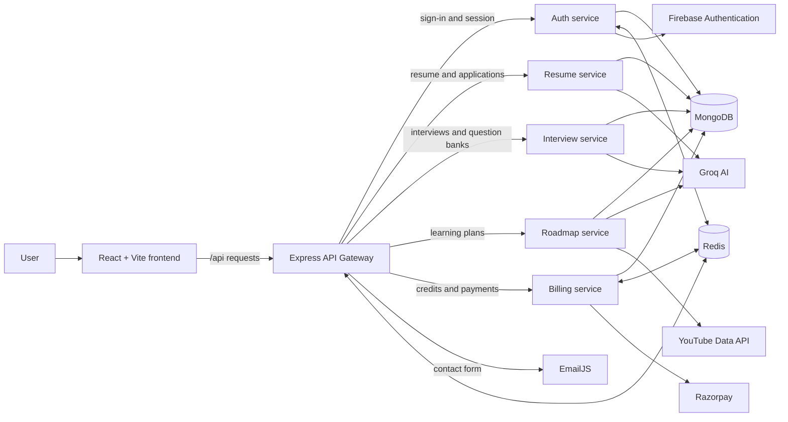

<div align="center">

# Intervue AI

### Your AI-powered interview preparation workspace

Practice interviews, improve your resume, track your progress, and make a plan for the role you want.

[](https://github.com/TheLearnerAllTime002/Intervue-AI)
[](https://react.dev/)
[](https://nodejs.org/)

[Explore the code](https://github.com/TheLearnerAllTime002/Intervue-AI) · [Report an issue](https://github.com/TheLearnerAllTime002/Intervue-AI/issues) · [Contact](https://github.com/TheLearnerAllTime002/Intervue-AI/issues/new)

</div>

---

## About

Intervue AI is an open source career preparation app built around a simple idea: interview practice should lead to clear, useful next steps. It brings AI-assisted practice and career tools together in one workspace, so you can prepare, review your progress, and keep your materials organized.

The project is created by **Arjun Mitra** ([`@TheLearnerAllTime002`](https://github.com/TheLearnerAllTime002)). Contributions of all sizes are welcome, from fixing a typo or reporting a bug to building a feature.

## What you can do

| Feature | What it helps with |
| --- | --- |
| **AI mock interviews** | Practice HR, technical, and coding interviews with questions tailored to a role, experience level, and optional resume. |
| **Interview reports** | Review answer feedback, scores, strengths, areas to improve, and recommendations after a session. |
| **Question banks** | Save interview questions and your answers, organize your own practice library, and add custom questions. |
| **Resume builder and scorer** | Create resume content and get AI-assisted suggestions to strengthen it for a target role. |
| **Cover letters** | Draft role-specific cover letters from your career details. |
| **Learning roadmaps** | Turn a target role and skill gaps into a learning plan with suggested resources. |
| **Progress dashboard** | Review interview history, scores, streaks, weekly goals, and skill trends. |
| **Job applications** | Keep application details, stages, deadlines, and notes together. |
| **Coins and billing** | Manage interview credits and purchase additional credits through Razorpay. |
| **Installable app** | Use the Progressive Web App shell on supported browsers. The offline shell does not make API data or sign-in available offline. |

## How the system fits together

The frontend talks to one public API entry point: the Gateway. The Gateway handles session checks for protected requests and forwards each request to the service that owns that feature. The backend is split into independently runnable Node.js services, with MongoDB for application data and Redis for session-related coordination.



### Backend services

| Service | Default port | Responsibilities |
| --- | ---: | --- |
| **Gateway** | `8000` | Public API entry point, CORS, request IDs, authentication middleware, downstream proxying, and contact form endpoint. |
| **Auth** | `8001` | Verifies Firebase sign-in, creates and validates application sessions, and manages user identity. |
| **Resume** | `8002` | Resume data and generation/scoring flows, cover letter content, and job application records. |
| **Interview** | `8003` | Interview creation, question and answer flow, feedback and summaries, interview history, and personal question banks. |
| **Roadmap** | `8004` | AI-generated learning plans and suggested learning resources. |
| **Billing** | `8005` | Coin balance and Razorpay order/payment workflows. |

**Shared infrastructure:** MongoDB stores service data. Redis supports session coordination between Gateway, Auth, and Billing. In the local Docker Compose setup MongoDB is exposed at `127.0.0.1:27017` and Redis at `127.0.0.1:6380`.

### Typical request flow

1. A user signs in with Firebase Authentication.
2. The frontend sends requests to the Gateway under `/api`.
3. For protected routes, Gateway validates the application session and forwards the request with trusted internal user context.
4. The feature service reads or updates its data and, where needed, calls an external provider such as Groq or Razorpay.
5. The service returns a response through the Gateway to the frontend.

The services use `INTERNAL_SERVICE_SECRET` to protect trusted service-to-service context. In production, configure the same secret on the Gateway and every protected backend service. Gateway, Auth, and Billing must also use the same Redis endpoint and database index for session and balance coordination.

## Tech stack

- **Frontend:** React, Vite, React Router, Redux Toolkit, Tailwind CSS, Motion, Recharts
- **Backend:** Node.js, Express, Mongoose, LangChain/LangGraph
- **Data and sessions:** MongoDB, Redis
- **AI:** Groq models for interview, resume, and roadmap assistance
- **Authentication:** Firebase Authentication
- **Payments:** Razorpay
- **Local infrastructure:** Docker Compose
- **Deployment:** Vercel configuration for the frontend; backend services include Dockerfiles

## Run locally

### Prerequisites

- Node.js **20.19 or newer** and npm
- Docker Desktop with Docker Compose
- Firebase project and web API key
- Groq API key for AI-backed services
- Optional provider credentials for Razorpay, YouTube Data API, and EmailJS

### 1. Install dependencies

From the repository root:

```bash
npm ci --prefix frontend
npm ci --prefix backend
npm ci --prefix backend/gateway
npm ci --prefix backend/services/auth
npm ci --prefix backend/services/resume
npm ci --prefix backend/services/interview
npm ci --prefix backend/services/roadmap
npm ci --prefix backend/services/billing
```

### 2. Create local environment files

```bash
npm run setup:local
```

This copies each `.env.example` to a missing `.env` file. Existing `.env` files are left untouched. Fill in the placeholders before using the services that need those credentials.

Important settings:

| File | Settings to provide |
| --- | --- |
| `frontend/.env` | `VITE_FIREBASE_API_KEY`; optionally `VITE_BACKEND_URL` and `VITE_RAZORPAY_KEY_ID` |
| `backend/gateway/.env` | service URLs, `FRONTEND_URL`, Redis URL, internal secret, and EmailJS keys |
| `backend/services/auth/.env` | MongoDB URL, Redis URL, internal secret, and Firebase Admin credentials |
| `backend/services/resume/.env` | MongoDB URL, Groq API key, internal secret |
| `backend/services/interview/.env` | MongoDB URL, Groq API key, internal secret |
| `backend/services/roadmap/.env` | MongoDB URL, Groq API key, YouTube API key, internal secret |
| `backend/services/billing/.env` | MongoDB URLs, Redis URL, internal secret, Razorpay credentials |

For local development, `setup:local` templates use MongoDB at `mongodb://127.0.0.1:27017/intervue_service` and Redis at `redis://127.0.0.1:6380`. Use the same database for `AUTH_MONGODB_URL` and `MONGODB_URL` in Billing so coin updates target the Auth user record.

### 3. Start the app and backend

```bash
npm run dev
```

The local launcher starts MongoDB and Redis with Docker Compose, then starts the frontend, Gateway, and all five backend services. Stop the processes with `Ctrl+C`.

To run only the frontend (with a separately running backend):

```bash
npm run dev:frontend
```

The frontend defaults to `http://localhost:5173`; the API Gateway defaults to `http://localhost:8000`.

> Local MongoDB is configured without credentials and is bound to loopback for development. Do not expose it to a public network.

## Environment and deployment notes

- Keep API keys and secrets in environment variables. Never commit `.env` files or Firebase service-account credentials.
- Set a long, random `INTERNAL_SERVICE_SECRET`; use the same value across Gateway and protected services.
- In production, configure `FRONTEND_URL` and all service URLs on Gateway.
- Gateway, Auth, and Billing must point to the same Redis endpoint, including its database index.
- The checked-in root `vercel.json` configures the repository-root frontend deployment. Set `VITE_FIREBASE_API_KEY` in the Vercel project environment. `frontend/vercel.json` applies when Vercel's Root Directory is set to `frontend`.
- Backend service-specific variables are documented in each service's `.env.example`. Review `backend/LOCAL_DEV.md` for additional local and production authentication configuration.

## Useful commands

```bash
# Frontend development server
npm run dev:frontend

# Production frontend build
npm run build

# Frontend lint
npm run lint

# Frontend tests
npm --prefix frontend test

# Gateway and Auth tests
npm --prefix backend test

# Stop local MongoDB and Redis
docker compose -f backend/docker-compose.yml down
```

## Project layout

```text
.
├── frontend/                 # React application, pages, components, and API clients
├── backend/
│   ├── gateway/               # API gateway, authentication middleware, and proxying
│   ├── services/
│   │   ├── auth/              # Firebase verification and app sessions
│   │   ├── resume/            # Resume, cover letter, and applications
│   │   ├── interview/         # Interviews, feedback, and question banks
│   │   ├── roadmap/           # Learning plans and resources
│   │   └── billing/           # Credits and Razorpay payments
│   ├── shared/                # Shared session, Redis, and diagnostics helpers
│   └── docker-compose.yml     # Local MongoDB and Redis
├── scripts/                   # Local environment setup and development launcher
└── README.md
```

## Contributing

Contributors are welcome! A useful contribution can be a bug report, documentation improvement, accessibility fix, design refinement, or new feature.

1. **Open an issue** to discuss larger changes or report a reproducible bug.
2. **Fork** the repository and create a focused branch from `main`.
3. **Make your change** and keep it scoped to one improvement where possible.
4. **Run the relevant checks** (`npm run lint`, `npm run build`, and the applicable tests).
5. **Open a pull request** with a clear summary, screenshots for UI changes, and notes about any environment changes.

Please do not include secrets or real user data in commits, screenshots, logs, or issue reports. For changes that touch service boundaries or shared request/session behavior, describe the request flow and compatibility impact in the pull request.

**Repository:** [github.com/TheLearnerAllTime002/Intervue-AI](https://github.com/TheLearnerAllTime002/Intervue-AI)

## License

See [LICENSE](LICENSE) for the terms that apply to this project.

---

<div align="center">

Made by **Arjun Mitra** · Built in the open · Contributions welcome

</div>
